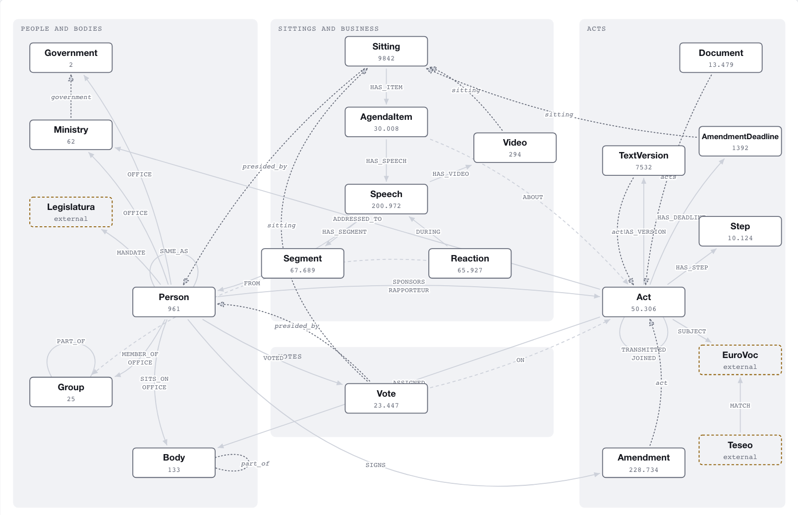

# Mirko Tritella

**I build AI tools that make public information easier to explore, understand and verify.**

I work on AI interfaces to official records and open government data. Every answer these systems give links back to its source. The work combines public data, information retrieval, knowledge graphs and language models.

[Website](https://emeierkeio.github.io/) · [LinkedIn](https://www.linkedin.com/in/mirko-tritella-4406951a3) · [ORCID](https://orcid.org/0009-0000-8611-8189) · [Publications](https://emeierkeio.github.io/#publications)

  

## ParliamentRAG

A research project on the official records of the Italian Parliament, started at the University of Milano-Bicocca. Its research appears at ISWC 2026, in the In-Use Track and in Posters & Demos.

Parliament publishes every debate, act and roll-call vote as open data. That record answers most questions about what Parliament does, but finding who said what means reading hundreds of pages. ParliamentRAG organises the record so you can ask a question in plain language and check the answer. Every answer keeps three guarantees:

1. **Every parliamentary group.** Majority and opposition both appear, and each component of the Mixed Group counts on its own. When a group never spoke on the topic, the answer says so.
2. **Authoritative speakers.** An authority model ranks members on the topic by their speeches, acts, committee seats and roles.
3. **Exact quotes with official links.** Each quotation links to its passage in the official record. A check drops any quote that does not match the source word for word before you read it.

Everything lives at [www.parliamentrag.it](https://www.parliamentrag.it/): a chat, a dossier per topic with what each group said and how it voted, every roll-call vote seat by seat, amendments, an agenda of sittings and amendment deadlines, member profiles, an open API and an MCP server for AI assistants. It runs on our own server in Europe and updates every night from official open data.

> 1,207 plenary sittings · 469k speeches · 50k acts · 28.7k roll-call votes · 9.7M individual votes · 230k amendments  
> XIX Legislature, from October 2022 to today

<picture>
  <source media="(prefers-color-scheme: dark)" srcset="assets/grafo-scuro.png">
  
</picture>

**Stack:** RAG · PostgreSQL + pgvector · hybrid retrieval · authority-aware retrieval · citation verification · MCP

[Website](https://www.parliamentrag.it/) · [Code](https://github.com/Emeierkeio/ParliamentRAG) · [Dataset](https://doi.org/10.5281/zenodo.21560331)

## Publications

**Who Speaks Matters: Authority-Aware Multi-View Retrieval-Augmented Generation over Italian Parliamentary Proceedings**  
Mirko Tritella, Riccardo Pozzi, Matteo Palmonari · ISWC 2026, In-Use Track · Springer, to appear  
[PDF](https://emeierkeio.github.io/papers/who-speaks-matters-iswc2026.pdf) · [Dataset](https://doi.org/10.5281/zenodo.21560332) · [ORKG](https://orkg.org/papers/R1909763)

**ParliamentRAG: An Authority-Aware Multi-View RAG System for Italian Parliamentary Proceedings**  
Mirko Tritella, Riccardo Pozzi, Matteo Palmonari · ISWC 2026, Posters & Demos · CEUR-WS, to appear  
[PDF](https://emeierkeio.github.io/papers/parliamentrag-demo-iswc2026.pdf) · [Live system](https://www.parliamentrag.it/) · [Code](https://doi.org/10.5281/zenodo.23173703)

## Research

Public institutions publish more records than anyone can read. A language model can summarize them, but a summary without sources asks you to trust the model instead of the record. I build systems that show you what they retrieved, who said it, in which debate, and where to check it.

The questions I work on:

- How can an AI answer stay connected to its evidence?
- How should a system represent who is speaking, in which role and in which debate?
- How can knowledge graphs improve access to public records?
- How do you evaluate a system that summarizes public records, beyond answer accuracy?

**Topics:** retrieval-augmented generation · information retrieval · knowledge graphs · semantic web · LLM evaluation  
**Now exploring:** semantic axes for mapping political positions, and how parliamentary stances change over time.

## From open data to AI

I started with local public data. In Roseto degli Abruzzi, my home town, election results existed only as PDFs on the municipal website, so I extracted them and republished them as machine-readable data ([opendata-roseto](https://github.com/Emeierkeio/opendata-roseto)). During the pandemic I built a site that tracked the town's COVID-19 figures day by day ([roseto-covid](https://github.com/Emeierkeio/roseto-covid)). ParliamentRAG takes the same idea to the national parliament.

## Tools I work with

**AI and retrieval:** RAG · embeddings · LLMs · hybrid retrieval  
**Knowledge:** knowledge graphs · RDF · SPARQL · PostgreSQL · pgvector  
**Engineering:** Python · FastAPI · Docker · MCP

---

MSc Data Science, University of Milano-Bicocca · BSc Computer Science, University of Bologna  
Rome / Milan / Roseto degli Abruzzi · [mirko.tritella@parliamentrag.it](mailto:mirko.tritella@parliamentrag.it)
